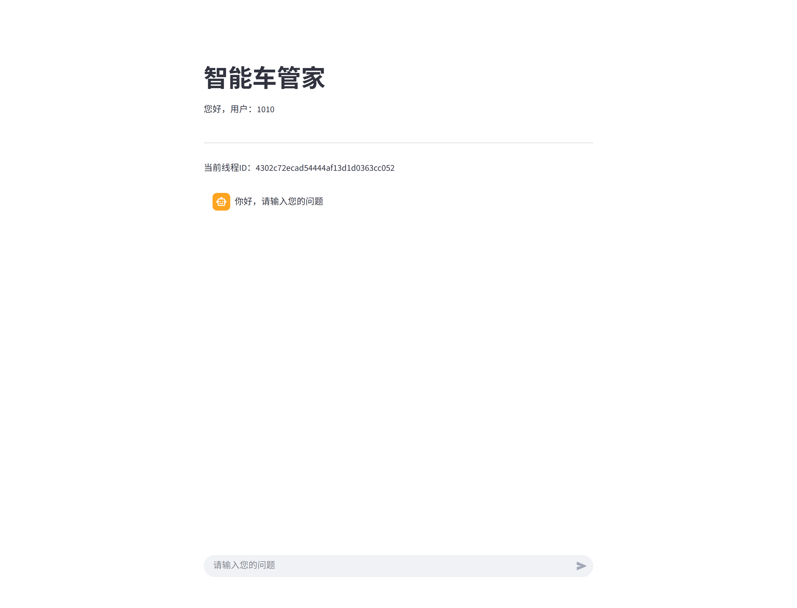
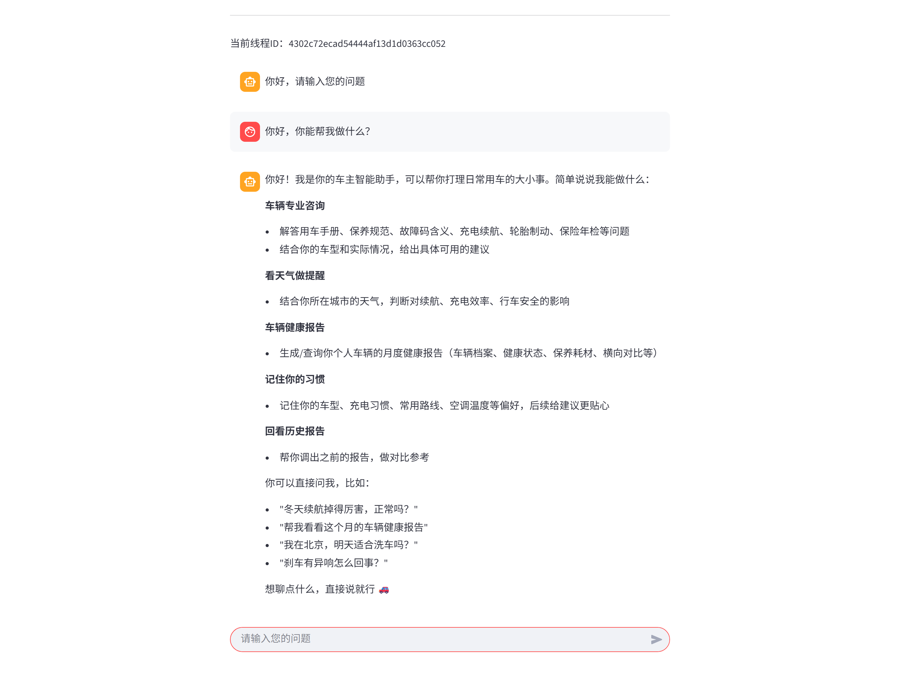
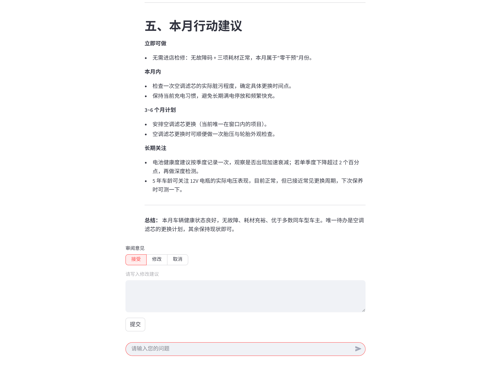
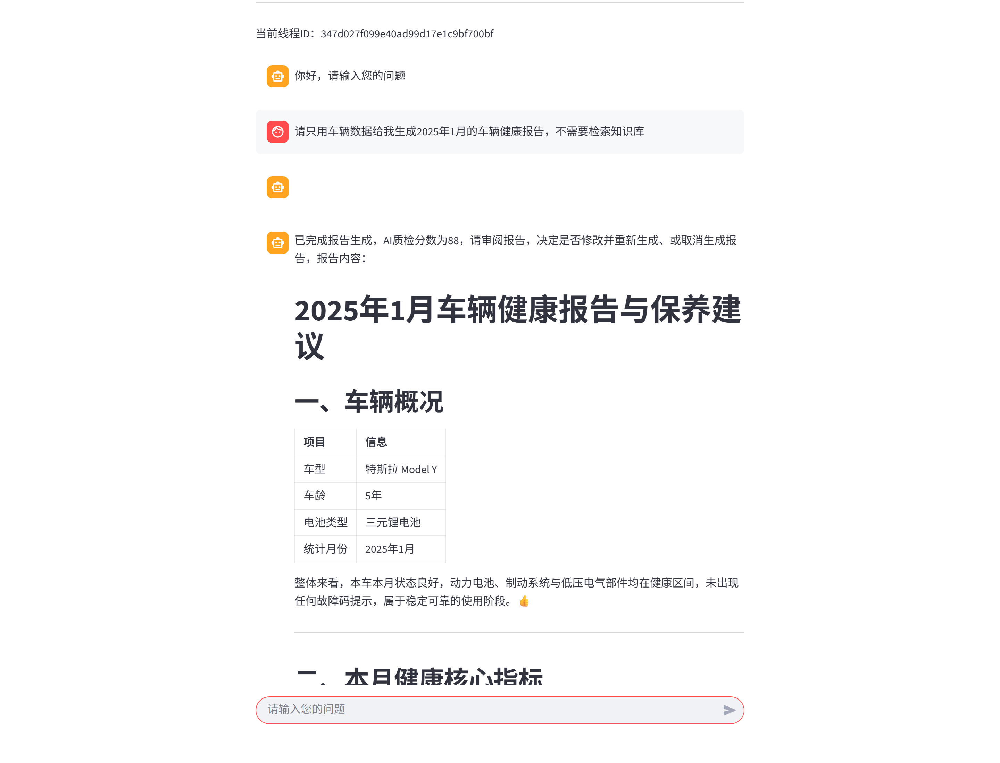
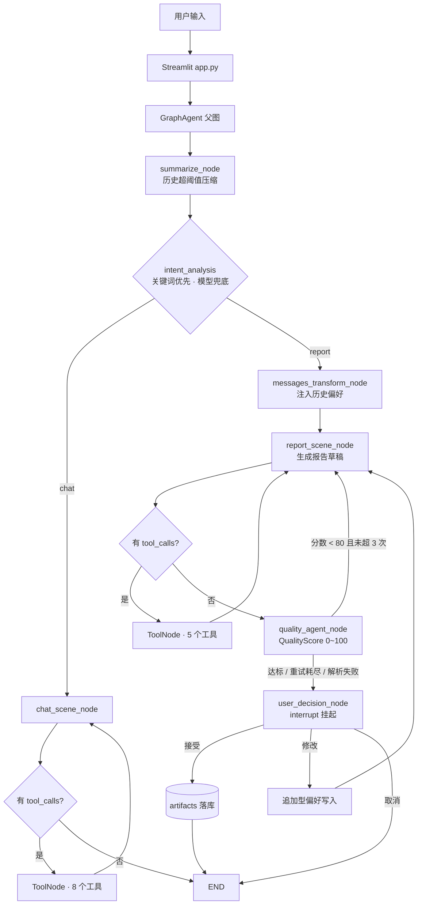

# 智能车管家 · LangGraph 车主客服 Agent


面向私家车主的智能客服 Agent：日常车辆问答走聊天子图，月度车辆健康报告走独立报告子图，报告流程内建 **AI 质检自动重生成** 与 **人工审阅中断（interrupt / resume）**。配套 **RAG 知识库**、**多级记忆**、**自建行为评测**，前端为 Streamlit。

## 界面预览

| 首页 | 聊天问答 |
| --- | --- |
|  |  |
| **报告人工审阅（interrupt）** | **报告正文与质检结果** |
|  |  |

## 核心能力

- **双场景路由**：先用「报告 / 报表 / report」关键词命中报告场景，未命中再交给小模型做结构化意图判定，失败兜底为聊天。
- **报告闭环**：生成草稿 → 工具补数据 → AI 质检打分 → 低于 80 分自动回炉（最多 3 次）→ 人工审阅（接受 / 修改 / 取消）→ 定稿落库。
- **人工审阅环**：`interrupt()` 挂起工作流，前端收集审阅意见后用 `Command(resume=...)` 恢复；选择「修改」会把建议写入长期偏好，后续报告自动遵守。
- **多级记忆**：会话上下文、长期用户画像 / 偏好 / 事实、追加型报告要求、历史消息摘要压缩。
- **RAG 问答**：特斯拉车主手册分册入 Milvus，按 MD5 去重，支持 `rag_search` 工具检索。
- **可靠性**：节点级 `RetryPolicy`、工具调用重试与日志钩子、LLM 空响应重试、失败降级为人工审阅。
- **自建评测**：基于 LangChain callback 采集工具 / 节点 / 中断等行为事实，表驱动断言，不依赖托管平台。

## 架构总览



- 父图见 [agent/graph_agent.py](agent/graph_agent.py)：`OverAllState` 继承 `MessagesState`，`SqliteSaver` 存检查点、`SqliteStore` 存长期记忆，`compile(checkpointer=..., store=...)`。
- 聊天子图见 [agent/subgraphs/chat_subgraph.py](agent/subgraphs/chat_subgraph.py)，报告子图见 [agent/subgraphs/report_subgraph.py](agent/subgraphs/report_subgraph.py)。

## 关键实现

### 1. 报告质检与回炉

质检模型通过 `with_structured_output(QualityScore)` 输出 0~100 的整数分数：

| 情况 | 处理 |
| --- | --- |
| 分数 ≥ 80 | 进入人工审阅 |
| 分数 < 80 且重生成次数 ≤ 3 | `Command(goto="report_scene_node")` 带质检意见重新生成 |
| 分数 < 80 且重生成次数 > 3 | 降级为人工审阅（`quality_score = -1`） |
| 质检结果解析失败 | 同样降级为人工审阅，不中断整条链路 |

### 2. 人工审阅中断

`user_decision_node` 内调用 `interrupt()` 把草稿报告交给前端，Streamlit 用 `segmented_control` 收集决策：

- **接受**：报告写入 `artifacts` 表，返回 `artifact_id`，可通过工具回查。
- **修改**：修改建议以追加型记忆写入 `偏好 / 报告要求`，然后回到生成节点重写。
- **取消**：直接结束本次报告流程。

### 3. 多级记忆

| 层级 | 载体 | 隔离键 | 说明 |
| --- | --- | --- | --- |
| 短期会话 | `SqliteSaver`（`databases/memory.db`） | `thread_id` | 多轮上下文与断点续跑，中断状态也存这里 |
| 长期用户 | `SqliteStore` + [long_term_memory_service.py](services/long_term_memory_service.py) | `user_id` | 用户画像 / 偏好 / 事实，属性受 `config/memory.yaml` 枚举约束 |
| 追加型记忆 | 同上，`append_attrs: [报告要求]` | `user_id` | 同 key 多次写入累积去重，超上限截断；其余分类为覆盖型 |
| 历史压缩 | `summarize_node` | `thread_id` | 消息数超 `summarization_trigger` 时摘要旧消息并重建消息列表 |
| 会话管理 | [session_service.py](services/session_service.py) | `user_id` | 会话创建与查询，始终按 `user_id` 过滤 |
| 产物库 | [artifact_service.py](services/artifact_service.py) | `user_id` | 定稿报告落 `databases/business.db` |

### 4. 工具层

工具定义在 [agent/tools/agent_tools.py](agent/tools/agent_tools.py)，`user_id` 通过 `RunnableConfig` 注入，模型无法伪造：

| 工具 | 作用 |
| --- | --- |
| `rag_search` | Milvus 向量检索知识库 |
| `get_current_month` / `get_weather` / `get_user_location` | 时间、天气、定位 |
| `fetch_external_data` | 按月份读取用户车辆数据（档案 / 健康 / 耗材 / 横向对比） |
| `save_long_term_memory` / `get_long_term_memory` | 长期记忆读写，Pydantic `args_schema` 约束分类-属性 |
| `get_user_artifacts_overview` / `get_user_artifact_detail` | 历史产物概览与详情 |

聊天子图挂载 8 个工具，报告子图挂载 5 个。

### 5. RAG

- `langchain-milvus` 本地文件模式（`milvus.db/`），`AUTOINDEX + COSINE`。
- `RecursiveCharacterTextSplitter` 分块，`chunk_size` / `chunk_overlap` / `separators` 均在 [config/milvus.yaml](config/milvus.yaml)。
- 入库文件以 MD5 记录去重（`rag/md5_hex_store.db`），知识库源文件位于 `data/`。

### 6. 自建评测

```bash
python -m evals.runner    # 全绿退出码 0，任一断言失败退出码 1
```

- [evals/trace_handler.py](evals/trace_handler.py)：`ToolTrace` 采集工具名、工具报错、实际执行节点，**只写不判**。
- [evals/evaluators.py](evals/evaluators.py)：通用算子 `subset` / `disjoint` / `equals` / `not_contains` / `is_empty` + `SPEC` 注册表，加验证点只需加一行映射。
- [evals/cases.jsonl](evals/cases.jsonl)：声明 `expect_tools` / `expect_scene` / `expect_interrupted` / `expect_no_tools` 与多轮 `resume_decision`。
- [evals/runner.py](evals/runner.py)：每次运行重置评测库（带路径校验），逐 case 新建隔离用户与线程，支持两轮中断恢复。

断言的是**行为**（调了哪个工具、进了哪个子图、是否中断、是否把内部错误漏给用户），不是文本措辞，因此不会因模型改写而假红。

## 快速开始

### 1. 安装依赖

```bash
pip install -r requirements.txt
```

### 2. 配置环境变量

在项目根目录创建 `.env`（参考 `.env.example`，已被 `.gitignore` 忽略）：

| 变量 | 说明 |
| --- | --- |
| `ollama_base_url` | Ollama 服务地址，默认 `http://localhost:11434` |
| `ollama_api_key` | Ollama 占位密钥 |
| `deepseek_base_url` / `deepseek_api_key` | 使用 DeepSeek 时填写 |

### 3. 准备模型

模型名称在 [config/rag.yaml](config/rag.yaml) 中，通过 provider 前缀（`ollama:` / `deepseek:`）切换，不改代码：

```yaml
chat_model_name: ollama:qwen3.5:9b
embedding_model_name: ollama:qwen3-embedding:4b
# chat_model_name: deepseek:deepseek-chat
```

```bash
ollama pull qwen3.5:9b
ollama pull qwen3-embedding:4b
```

### 4. 知识库入库

```bash
python -m rag.vector_store    # 首次运行，需要在项目根目录以模块方式执行
```

### 5. 启动前端

```bash
streamlit run app.py
```

### 6. 运行评测

```bash
python -m evals.runner
```

## 项目结构

```text
agent/graph_agent.py          父图：意图路由、历史压缩、流式输出与中断转发
agent/subgraphs/              chat_subgraph.py（对话 + 工具循环）
                              report_subgraph.py（生成 - 质检 - 审阅环）
agent/tools/agent_tools.py    工具定义
model/factory.py              模型工厂与 provider 注册表
rag/                          rag_service.py 检索服务
                              vector_store.py 分块入库与 MD5 去重
services/                     session / artifact / long_term_memory 服务
utils/                        配置、日志、路径、提示词、钩子、流式提示
config/                       agent / business / memory / milvus / prompt / rag
prompts/                      system / report / report_quality / intent / summary
data/                         知识库源文件与外部业务数据
evals/                        callback 采集 + 表驱动判定 + runner
docs/screenshots/             README 展示截图
app.py                        Streamlit 入口（流式渲染、中断审阅面板）
```

## 配置说明

| 文件 | 内容 |
| --- | --- |
| `config/rag.yaml` | 对话 / 嵌入模型名（provider 前缀决定走哪个工厂） |
| `config/milvus.yaml` | 向量库目录、集合名、top-k、分块与分隔符、维度 |
| `config/memory.yaml` | 记忆库路径、长期记忆分类与属性枚举、追加型 attr、摘要阈值 |
| `config/business.yaml` | 业务库路径、产物与会话表名 |
| `config/prompt.yaml` | 五个提示词模板路径 |
| `config/agent.yaml` | 外部报告数据源路径 |

## 技术栈

| 类别 | 选型 |
| --- | --- |
| Agent 编排 | LangGraph 1.2.11（父图 + 双子图、checkpointer、store、interrupt / resume） |
| 模型接入 | LangChain 1.3.16 `init_chat_model` / `init_embeddings`，Ollama / DeepSeek |
| 向量库 | Milvus（langchain-milvus 本地文件模式） |
| 持久化 | SQLite（检查点、Store、会话、产物、业务数据） |
| 前端 | Streamlit 1.51 |
| 语言 | Python 3.13 |

## 说明

- 仓库内车辆数据为演示数据（`data/external/records.csv`），`app.py` 默认以 `user_id=1010` 演示。
- 天气、定位、当前月份工具为演示实现，可替换为真实服务。
- 切换模型只需修改 `config/rag.yaml` 一行；密钥与地址统一走 `.env`，不入库不入仓。
